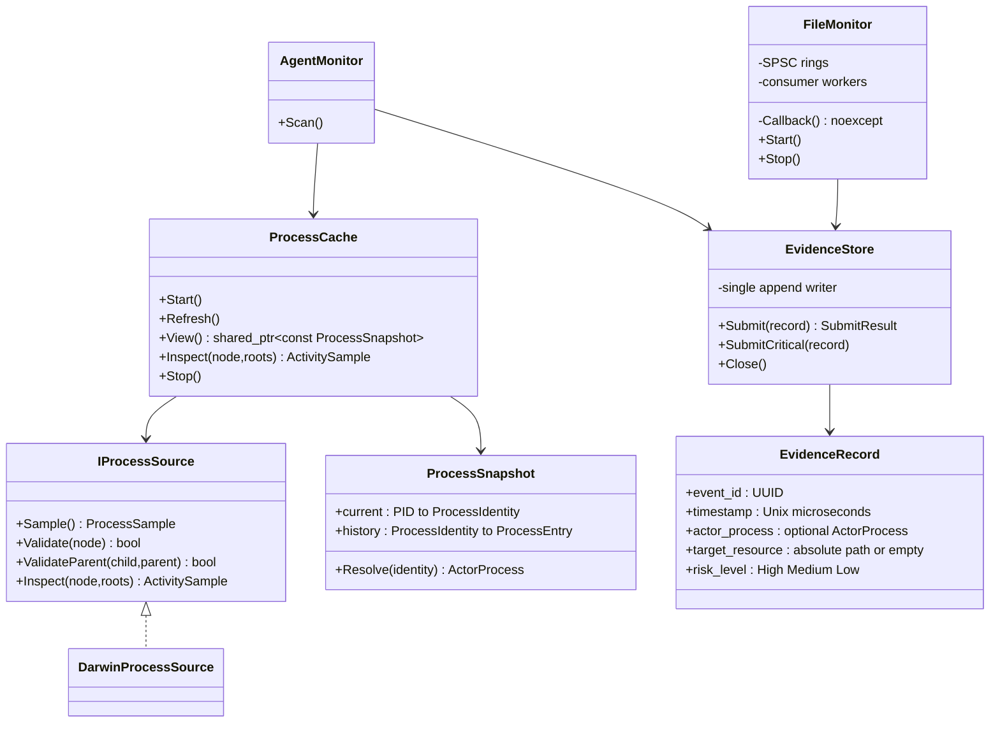
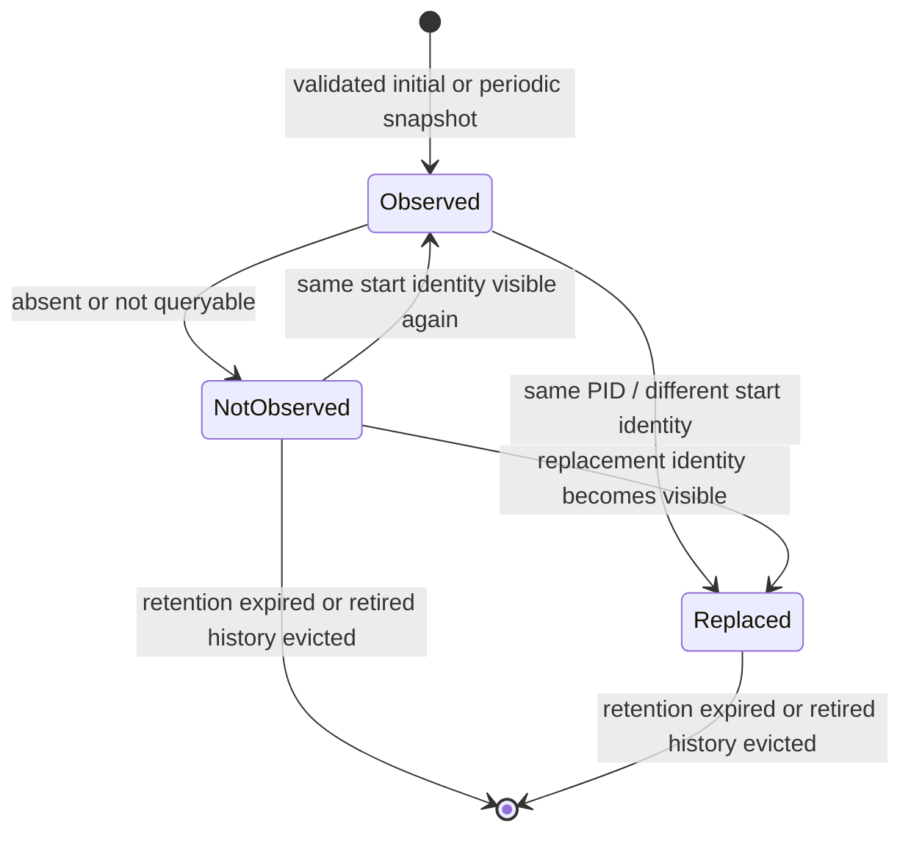
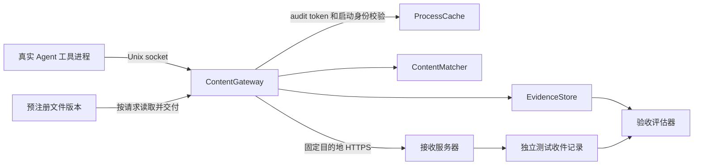

# Runtime collector v2 architecture

## 模块与数据流

生产编译单元为 main.cpp、ProcessCache.cpp、DarwinProcessSource.cpp、FileMonitor.cpp、AgentMonitor.cpp、EvidenceStore.cpp；共享类型在 Types.h，资源包装在 SystemResources.h，队列在 SpscRing.h。没有第三方队列或 JSON 依赖。

## 未知与未来 Agent

采集策略不由品牌名称白名单控制。AgentMonitor 为所有可见进程发布 process_discovered 清单，默认分类 unclassified_process；识别到已知名称、应用目录、CLI 分发路径或已观察祖先时才标记 known_agent_candidate。分类结果和 classification_reason 写入 actor_process。未知进程不因为缺少名称规则而跳过敏感资源策略。

所有可见进程的敏感文件描述符由最多 4 个并发扫描任务检查。未知进程持有目标文件时才展开 socket 对端，减少无关连接收集；已知候选可直接观测对端。健康指标记录扫描进程数、候选数、身份校验失败数、描述符不完整数和实际扫描耗时。这里的“可见”包括权限/身份校验限制，不等于内核中所有进程。

新应用可通过 `--agent-bundle 'Example.app'` 添加标签，无需改代码。即使没有标签，敏感文件活动也会记录。Grok Bot 在本次默认规则中保持未知进程，正用于验证清单不依赖品牌穷举；这不意味着从进程元数据已经证明了其 Agent 语义或正在执行 AI 任务。

默认清单记录可执行路径、进程身份和父链，会增加日志量和隐私范围；原始整机日志不纳入公开测试报告。真实测试使用独立 ps 路径基线、隔离合成文件、子进程自报 PID、脚本校验和、回环服务端收件和采集器记录交叉核对；模型回答不能代替执行凭据。

## 进程状态与身份

身份键为 `(pid, start_seconds, start_microseconds)`，来自 `PROC_PIDTBSDINFO`。Darwin 数据源查询元数据前后验证启动身份，并检查可执行路径；描述符采样也在前后验证身份/路径。只要任一校验失败，就不发布该次活动。相同启动身份的 exec 路径变化会产生 changed 记录；该方式不能观测所有瞬间 exec，也不能区分相同路径的 exec。

NotObserved 不声称进程一定已退出。历史父链只在父、子身份与 PPID 通过校验后绑定，且父启动时间不能晚于子。绑定后不因 PID 复用或 reparenting 覆写；`ppid` 为最近快照值，`observed_parent_identity` 为历史已观察链接。祖先缺失、过期、被容量淘汰或出现循环时显式标记不完整，不拼接到同 PID 的新进程。

默认历史保留 300 秒，目标上限 32768 条，优先淘汰非当前条目；若可见活进程本身超过该数，保留活进程，健康记录暴露规模。不可变快照通过 C++17 atomic shared_ptr 发布；该原子 shared_ptr 本身不保证无锁，但它不在 FSEvents 回调链路上。刷新失败保留上一快照并通知主线程退出。

`chain_complete` 在三条边界上为 true：观察到 pid 1、观察到 ppid 0，或子进程的 ppid 被再次核对为 1 但 launchd 的可执行路径读不到（`chain_status` 为 `observed_chain_to_launchd`）。最后一种是普通用户态结果，因为 launchd 经常没有可读路径；它不编造 launchd 的启动身份。中间父进程仍然缺失时保持 `missing_parent`，不补链。

所属 Agent 写在 `owning_agent`：最靠近根、且命中应用 bundle 的进程优先，否则用最靠近根的已知 Agent 进程。事件里的 `summary` 用更靠近实际工具的产品名来写人话，例如 Codex 跑在 ChatGPT.app 里时，句子以 Codex 为主语，bundle 与根 pid 仍指向 ChatGPT.app。采集器自身（`agent-monitor`、`ReinsRuntime`、`ReinsDashboard`、`ReinsCredential.app`）标记为 `collector_self`，不作为嫌疑 Agent。其他安全工具保持 `unclassified_process`。

已知 Agent 树使用 kqueue 的 fork/exec 通知，并在短窗口内重复采样子进程文件描述符，用来抓住远短于 500ms 全局扫描的打开。敏感路径集合上的访问时间变化单独记录：没有进程时 `evidence_basis` 为 `access_time_change`；恰好一个 Agent 后代的存活区间与之重叠、且没有看到文件描述符时为 `inferred`。看到描述符则为 `fd_observed`。三种都不是上传证据。FSEvents 仍然没有 actor。

只保留解释器分类所需的 argv[0]、入口参数和可选 Python -m 模块；不保留提示词或环境数据，临时 sysctl 缓冲区在所有退出路径擦除。普通日志不输出 argv。依然不能保证任意程序自定义 argv 内容不含敏感字符串，缓存仅驻留本机内存。

## 回调与并发

FSEvents 绑定串行 dispatch queue，保证单生产者。启动时为每个消费者预分配一个 SPSC ring，每片 1023 个可用槽，默认 2 片。RawFileEvent 只有固定大小的路径、源 ID、flags 和观测时间。回调执行有界路径复制与原子索引操作，不进行 libproc、文件 I/O、锁等待、堆分配、UUID 或 JSON 序列化。后端消费者轮询间隔为 2ms。

每片固定一个消费者，避免把 SPSC 错用为 MPMC。回调分片，不进行工作窃取；某片满时明确丢弃并累计计数。超长路径不静默截断。OS dropped/root-change 事件进入结构化 sensor_gap，额外计数保证即使队列满也能在健康记录中报告覆盖缺口。

stream 设置 IgnoreSelf，避免日志位于监控树内时因采集器自身追加而形成反馈循环；这也意味着采集器自身文件变更被有意排除。其他进程的事件仍由 FSEvents 正常合并/交付。

这是算法层面不等待队列空间，并不是 macOS 调度、缺页或时钟查询的硬实时保证。后台 Submit 使用有界互斥队列，允许分配，仅由非回调线程调用。多消费线程可能重排源事件，`source_event_id` 保留 OS 顺序线索；文件 `sequence` 是实际追加顺序，不能冒充操作发生顺序。

## 证据与真实归因

FSEvents **没有操作 PID，也没有逐次操作时间或纯读取事件**。文件变更记录必须是 `actor_process: null`，归因状态为 `unavailable_fsevents_has_no_actor`。不能从缓存选一个同时存在的 Agent 充当文件修改者。

进程活动记录可附带经过身份验证的描述符快照及历史父链，但 `sensitive_file_open` 只证明观察到文件描述符；`socket_peer` 只证明观察到对端；同轮扫描的共现为 Medium 风险提示，不能证明读写或上传。High 默认用于证据缺失/传感器故障。`chain_complete` 只表示历史已观察链接能追到根，不表示系统全生命周期、原始生父链或操作因果链完备。

时间为 Unix 微秒观测时间，不承诺微秒精度，也不是 FSEvents 操作时间。UUID v4 标识事件；session_id 区分运行，sequence 标识单次运行的落盘顺序。target_resource 对文件事件为绝对路径；进程/健康事件无文件目标时为空。`target_resource_bytes_hex` 保留原始路径字节，避免非法 UTF-8 导致 JSON 无效或目标不可恢复。

## 资源与关闭

CFArray、CFString、FSEventStream、dispatch queue 均由 unique_ptr 配合对应 deleter 管理；FD 由 unique_ptr 管理的 FdHandle 封装。代码不使用裸 new/delete。C API 的借用指针与回调 void* 上下文不承担所有权；不能禁止这些 API 必需的非拥有指针。

控制线程停止 stream、invalidate，再对串行队列做 barrier 排空回调，随后释放 stream/dispatch。此时才设置消费者停止标记；消费者二次检查并排空 ring 后退出。进程缓存停止，主线程提交 shutdown_summary，最后 EvidenceStore 排空、fsync、join 并释放文件。启动异常和部分线程创建失败也走同一 RAII 清理路径。Start/Stop/Close 生命周期操作只由控制线程调用；Submit/SubmitCritical 支持并发生产者。

## 落盘、安全与故障

文件使用 `O_APPEND | O_CREAT | O_RDWR | O_CLOEXEC | O_NOFOLLOW`，新建模式 0600。拒绝非本人所有、非普通文件、多个硬链接或权限非 0600 的日志。O_NONBLOCK 防止检查前被 FIFO 卡住；flock 排除协作式重复写入者。日志目录必须是可信目录；O_NOFOLLOW 不保护整个祖先路径，也不能防御文件所有者或 root 篡改。

单线程完成 JSONL 全记录追加，循环处理 EINTR/短写，默认每条 fsync，Close 最终同步；文件目录也 fsync。出现写入/同步错误停止继续写，主线程收到错误后非零退出；不把入队当作持久化确认。已接收入队到 fsync 完成前仍存在崩溃丢失窗口。日志尾行不完整时拒绝启动并保留原文件，需运维显式封存/切换路径，不自动截断证据。

回调队列溢出、路径过长、OS gap、证据队列满都计数，通过 coverage/shutdown_summary 报告，健康退出码为 2 表示覆盖缺失，致命错误退出码为 1。致命错误以同样 schema 输出 stderr，磁盘失效时不能保证还能将故障写回失效磁盘。队列满时普通记录不等待，SubmitCritical 仅用于控制线程健康/关闭记录，有超时并传播失败。

本地追加并不等于内核强制 append-only、防篡改、WORM 或远端持久化。默认逐条 fsync 的吞吐需按部署负载评估；当前实现不做自动日志轮转、压缩或删除。

## 部署验收范围

该重构实现生产架构所需的职责边界、资源管理、损失计量和故障传播，但不能据此宣称已获企业生产验收。无 ESF 的轮询仍会遗漏短命、权限不可见、未知/改名 Agent 和瞬间活动；PID+启动时间不能成为操作系统原子进程句柄，也不能识别任意同进程 exec。缓存消除的是按 PID 拼接到新身份的错误设计，不是彻底消除内核状态竞态。

上线还需实际负载/长稳测试、Intel 实机验证、部署签名/权限与 launchd 管理、日志轮转与保留策略、故障告警接入。需要真实读写者或上传内容时，应接入有相应授权的事件源或受控内容出口；不能伪造 FSEvents 的能力。

Apple 参考：[FSEvents](https://developer.apple.com/documentation/coreservices/file_system_events)、[dispatch 调度约束](https://developer.apple.com/documentation/coreservices/1444164-fseventstreamsetdispatchqueue)、[进程结构](https://github.com/apple-oss-distributions/xnu/blob/main/bsd/sys/proc_info.h)。

## 显式接入的内容传感器（实验性）

`ContentGateway.cpp` 是独立可执行文件，复用 ProcessCache、EvidenceStore 和 AgentMonitor 的候选规则；`ContentMatcher.cpp` 提供整版本原文、JSON、Base64 和单层有界 gzip 匹配。

网关要求属主拥有的 0700 socket 目录；连接接受时用 LOCAL_PEERTOKEN 和 proc_pidpath_audittoken 验证连接方，前后核验 PID+启动时间。它记录的是连接创建方，不宣称能够阻止同 UID 进程转交 socket、伪装名称或修改同属主文件。只有可见祖先会进入链条，缺失身份不补造。

HTTP 输入限制：8KiB 头、1MiB body、5 秒读取截止；拒绝重复长度、chunked、未知路径和超限输入。上游固定，不跟随重定向，不转发客户端认证头，启用 TLS 校验，连接/传输截止分别为 5/15 秒，响应至多 2MiB。网关串行处理请求、listen backlog 为 16；8 并发功能测试不构成高吞吐或抗拒绝服务保证。该实验性通道不改变 FSEvents 回调队列。

文件内容交付、内容匹配和网络结果是不同事件。内容匹配来源是预注册版本；同内容可来自其他副本，因此不证明唯一原生读取来源。关联使用同一已观察 Agent 祖先身份和内容，默认保留 1 小时（可配置 1–86400 秒），最多 256 条交付记录；超时、重启、淘汰或跨网关实例不会补造链接。发送结果可能在进程退出后写入，保留此前经验证的身份；timestamp 是各记录阶段的观测时间。

EvidenceStore 异步追加，关键提交会等待队列空间或报错，但不是与上游网络发送的原子事务；故障期间可能存在部分发送或证据未持久化。上游 2xx 只是协议响应，接收端收件必须独立核对。此版本不自动拦截任意 HTTPS，也不做 TLS 中间人。完整逐功能验收与已知失败见 [ACCEPTANCE_REPORT.md](ACCEPTANCE_REPORT.md)。
