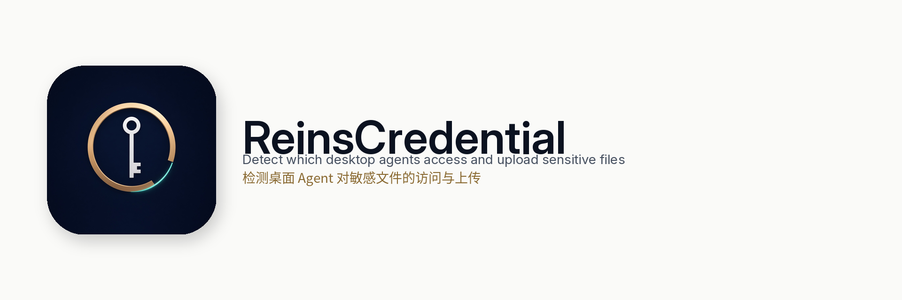

[English](README.md) · [简体中文](README.zh-CN.md)

<picture>
  <source media="(prefers-color-scheme: dark)" srcset="brand/ReinsCredential-Wordmark-dark.png">
  <source media="(prefers-color-scheme: light)" srcset="brand/ReinsCredential-Wordmark-light.png">
  
</picture>

# ReinsCredential

ReinsCredential shows which desktop app on your Mac opened a registered sensitive file — Claude, Cursor, Codex, Grok, Kiro, WorkBuddy, or any app that is not on that list — and whether the evidence it could see says that file was uploaded, only attempted, not found, or not visible. It keeps that record as an evidence chain you can read and export, without a system extension, a root daemon, a certificate authority, keychain changes, or edits to other apps' configuration.

The product name is ReinsCredential in every language. A file-open sentence means the file was open in that process or, when the sentence says so, that only the file's access time overlapped one short-lived tool. An open is not an upload.

## Use the Mac App (macOS 13+)

The app is the path for day-to-day use. It needs macOS 13 or later and Xcode Command Line Tools only when you build it yourself. Marketing version stays `0.2.0`.

### Option A: Download a release (when tagged)

Release packages are attached only when someone pushes a `v*` tag. The workflow in [`.github/workflows/release.yml`](.github/workflows/release.yml) uploads:

- `ReinsCredential-0.2.0-local.dmg`
- `ReinsCredential-0.2.0-local.zip`
- `SHA256SUMS.txt`

No release is published on [Releases](https://github.com/yardfribley-bit/ReinsCredential/releases) yet. Use Option B until a release is tagged.

When a tag exists, download those three files into one folder and check them before opening either archive. The checksum file lists the disk image and the zip by file name:

```sh
shasum -a 256 -c SHA256SUMS.txt
```

Open the disk image, or unzip the archive, and drag `ReinsCredential.app` to `/Applications` or `~/Applications`.

A package built without a Developer ID is ad-hoc signed. The tag workflow uses a Developer ID only when `REINS_SIGNING_IDENTITY` is set, and it notarizes only when `APPLE_ID`, `APPLE_TEAM_ID`, and `APPLE_APP_SPECIFIC_PASSWORD` are all set. Otherwise the attached app stays ad-hoc and unnotarized. Gatekeeper then treats it as unidentified and can block the first open. Control-click (or right-click) the app, choose **Open**, then **Open**. After a blocked double-click, **System Settings → Privacy & Security → Open Anyway** is the same per-app exception. Do not turn off SIP, Gatekeeper, or any other system security control. Building locally (Option B) is the other way to get the app onto the Mac.

### Option B: Build and install from source

Requires Xcode Command Line Tools (`swift`, `clang++`). From the repository root:

```sh
git clone https://github.com/yardfribley-bit/ReinsCredential.git
cd ReinsCredential
macOSClient/scripts/build-app.sh
macOSClient/scripts/install-local.sh
```

`build-app.sh --arch arm64 --arch x86_64` passes both architectures through to the Swift build and the C++ helpers. Running that universal app on each architecture is a separate check; this repository does not treat a compile as proof that both architectures were executed.

`install-local.sh` copies `macOSClient/dist/ReinsCredential.app` to `~/Applications/ReinsCredential.app` and opens it. It does not install into `/Applications`. If `~/Applications/ReinsCredential.app` already exists, the script stops and leaves the old app in place. Quit it, replace or remove it in Finder, then run the script again. Pass `--no-open` to skip the launch. The script never deletes `~/Library/Application Support/ReinsCredential`.

With `REINS_SIGNING_IDENTITY` unset, the build is ad-hoc signed and uses the same Gatekeeper path as an unnotarized download. Set that variable to a Developer ID before `build-app.sh` when you have one. `notarize-local.sh` notarizes a packaged disk image only when the three Apple credential variables above are set; otherwise it exits 0 and leaves the current signature.

### First launch and everyday use

1. Open **ReinsCredential** and wait until the status reads **Monitoring**. **Monitoring · coverage limited** means the collector is on and some processes or descriptors cannot be observed. **Background running needs approval** means System Settings → General → Login Items & Extensions still has to allow this app. The first launch of an ad-hoc build registers a per-user LaunchAgent. A Developer ID build uses SMAppService. Neither is a root daemon.
2. Open **Watch scope** and add folders that hold sensitive files. A new install watches `~/.ssh`, `~/.aws`, `~/.config/gh`, `~/.netrc`, `~/.npmrc`, `~/.git-credentials`, `~/.docker/config.json`, `~/.kube/config`, `~/.config/gcloud`, and `~/.azure`. A project `.env` is not in that list until you add the project folder. Saving a change restarts collection and leaves a short gap.
3. Run the built-in self-test from the toolbar (**Self-test**) or the **Monitor** menu (**Run Self-Test**). It creates a synthetic file and a loopback connection so the collector can relate a process, a file, and a destination. It does not read a real credential, it does not send anything off the Mac, and a passing row is not an upload.
4. Switch language from the **Monitor** menu: **Follow System**, **简体中文**, or **English**. The menu title is **Monitor** in English and **监控** in 简体中文. The same three items read **跟随系统**, **简体中文**, and **English** when the interface is Chinese.
5. Select an evidence chain and export it as JSON or Markdown from the chain, or from the toolbar **More** menu (**Export Selected Chain as JSON** / **Export Selected Chain as Markdown**). **Export Time Window…** exports the chains in the current filter. Raw secret bytes are omitted. For a finished JSONL log, the same export is:

```sh
swift run --package-path macOSClient chain-export evidence.jsonl
swift run --package-path macOSClient chain-export --markdown evidence.jsonl
```

`chain-export` only reads completed logs. It does not start the collector.

Closing the window leaves the per-user background service running. **Stop Monitoring** stops collection. Risk notifications are posted only while the interface is open. Evidence stays on this Mac under `~/Library/Application Support/ReinsCredential`.

### Upgrade and uninstall

Stop monitoring and quit the old app before you replace it. Replacing the app does not delete the evidence directory. `install-local.sh` will not overwrite an app that is already at `~/Applications/ReinsCredential.app`.

Uninstall stops this product's per-user LaunchAgent and removes `~/Applications/ReinsCredential.app` and `/Applications/ReinsCredential.app`. Evidence stays unless you pass `--delete-evidence`:

```sh
macOSClient/scripts/uninstall-local.sh
macOSClient/scripts/uninstall-local.sh --delete-evidence
```

Full steps, including `--dry-run`: [macOSClient/INSTALL.md](macOSClient/INSTALL.md) ([简体中文](macOSClient/INSTALL.zh-CN.md)).

## Four verdicts

| Code | English | 中文 | Meaning |
| --- | --- | --- | --- |
| `uploaded` | Uploaded | 已上传 | Registered content was in a proxied request that succeeded, or the process tree's measured off-host send, summed across TCP and UDP/QUIC for the hold and a short tail, falls between the compression lower bound and the raw size plus 64 KiB. The basis is `flow_txbytes`, or `flow_txbytes_udp` when UDP/QUIC bytes are what bring that sum into the window because the TCP application bytes alone are still below the lower bound. |
| `attempted` | Attempted | 已尝试未成功 | The content matched and the transfer failed, or an off-host connect failed before a send of at least the lower bound, including a refused connection (`flow_attempt`). |
| `not_found` | Not found | 未发现 | Every off-host channel in the hold and the tail was measured, and the total is below the compression lower bound. A loopback send stays here (`loopback_not_off_host`). |
| `not_visible` | Not visible | 看不到 | A channel was missing, closed before its byte count was captured, or the measured total is above the file size plus 64 KiB. This is unresolved. It is not a clean bill, and it is not rewritten as Not found. |

Any non-collector process that opens a registered sensitive file is tracked. The owner is that process's own `.app`. When the process is not inside an app, Xcode and the Python.app it ships are toolchain hops, and the walk continues to the desktop app above them, including a name with spaces such as `Grok Bot.app`. Known names are display labels, not a detection gate. A startup-canary body match covers only that launched process. A later actor on the same file still gets its own close. The app's own processes are never the suspected agent.

## CLI and developer quick start

From the repository root, with Xcode Command Line Tools. The build uses the system CoreServices, libcurl, libbsm, and zlib. No extra packages are downloaded.

```sh
make
./agent-monitor --log ./evidence.jsonl
```

The command-line defaults are the same home paths as the app, plus `.env` in the directory where you launch `agent-monitor`. `--sensitive` adds a path. `--no-default-sensitive` clears the defaults first.

`agent-egress` is a local HTTP proxy on `127.0.0.1`. `--launch` sets proxy environment variables only for the process tree it starts. `--watch-live` watches processes that already have a registered file open; a name list does not choose them. Logs do not store raw secret bytes. Use a synthetic file:

```sh
./agent-egress --log ./evidence.jsonl --sensitive-file ./synthetic.env \
  --launch -- python3 your-synthetic-case.py
make check
make integration
```

`make acceptance` stays a strict gate and can return non-zero while known misses remain. Do not weaken it to make a report green.

## Privacy and security guarantees

ReinsCredential runs on the Mac where it is installed. It does not upload evidence, configuration, or file contents. Local data is under `~/Library/Application Support/ReinsCredential` (directory mode `0700`, logs mode `0600`).

- Logs, the dashboard, and both export formats omit raw secret bytes. Exports say `raw_secret_bytes: omitted`.
- The app does not read or write the login keychain, and it does not install a certificate authority there. An optional TLS CA is a file the operator passes to the proxy. It is not installed.
- It does not edit other apps' MCP or client configuration, and it does not set a system-wide proxy.
- The egress proxy listens on `127.0.0.1`. `--launch` sets proxy variables only on the process tree it starts. TLS that did not enter that proxy is not decrypted.
- A `flow_txbytes` or `flow_txbytes_udp` close is a local send-byte count on the process tree that held the file. It is not a decrypted body and not a receipt from the remote server. UDP and QUIC payloads are not read. A measured datagram count can still close as `uploaded` when it falls in the size window. An unmeasured UDP or QUIC channel stays `not_visible`.

Details: [PRIVACY.md](PRIVACY.md) ([简体中文](PRIVACY.zh-CN.md)).

## Known limits

- There is no Endpoint Security client. A subtree sweep can miss an open that ends before the next child scan. Immediate-exit `cat`, and other short-lived opens, are an incomplete recall. They are not full read coverage.
- FSEvents do not name the process that changed a file, and they do not report a pure read. A file-change record leaves the actor empty. An open descriptor is not proof the bytes were read. A socket peer is not a payload.
- TLS that did not enter the local proxy is not decrypted. A client handshake of at most 1024 sent bytes does not prove the file left. The recorded name is reverse DNS, or a hostname the network-statistics source already has. ClientHello bytes are not copied off the socket.
- `flow_txbytes` and `flow_txbytes_udp` count bytes the process tree sent. They are not a remote receipt. A send larger than the file plus 64 KiB stays `not_visible`. The file may be inside that traffic, and the count does not isolate it.
- The compression lower bound is the smaller of the raw size, gzip, zlib, and raw deflate. zstd is not computed. A zstd payload smaller than that bound can still be closed as `not_found`.
- `not_visible` is unresolved. It is not rewritten as `not_found`.
- Short off-host sends are kept after the socket closes from `com.apple.network.statistics` when that kernel control is available. A connection the control never reports can still be missed.
- The optional TLS CA file is used only for CONNECT bodies that enter the proxy.

## Documentation

| Topic | English | 简体中文 |
| --- | --- | --- |
| Install, upgrade, uninstall | [INSTALL.md](macOSClient/INSTALL.md) | [INSTALL.zh-CN.md](macOSClient/INSTALL.zh-CN.md) |
| Privacy | [PRIVACY.md](PRIVACY.md) | [PRIVACY.zh-CN.md](PRIVACY.zh-CN.md) |
| Release notes 0.2.0 | [RELEASE_NOTES_0.2.0.md](RELEASE_NOTES_0.2.0.md) | [RELEASE_NOTES_0.2.0.zh-CN.md](RELEASE_NOTES_0.2.0.zh-CN.md) |
| Changelog | [CHANGELOG.md](CHANGELOG.md) | [CHANGELOG.zh-CN.md](CHANGELOG.zh-CN.md) |
| Architecture | [ARCHITECTURE.md](ARCHITECTURE.md) | [ARCHITECTURE.md](ARCHITECTURE.md) |
| Release gate | [RELEASE_CRITERIA.md](RELEASE_CRITERIA.md) | [RELEASE_CRITERIA.zh-CN.md](RELEASE_CRITERIA.zh-CN.md) |

There is one architecture document, and it is written in Chinese. Uninstall is `macOSClient/scripts/uninstall-local.sh`, described in the install guides. The release gate names the checks behind each claim above.
