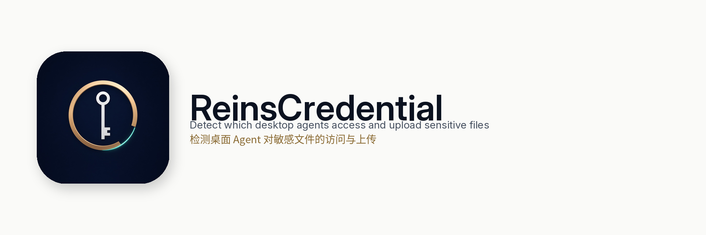

[English](README.md) · [简体中文](README.zh-CN.md)



# ReinsCredential

检测桌面 Agent 对敏感文件的访问与上传。

ReinsCredential 显示这台 Mac 上哪个桌面应用打开了已登记的敏感文件，以及该进程有没有把它传出去。两种语言里产品名都是 ReinsCredential，不另起中文产品名。

文件打开的句子表示文件曾在该进程中打开；如果句子写明，则只是访问时间与一个短生命周期工具重合。这本身不是上传。

## 结论

| 代码 | English | 中文 | 含义 |
| --- | --- | --- | --- |
| `uploaded` | Uploaded | 已上传 | 已登记内容出现在成功的代理请求里，或同一进程向非回环地址发送的 TCP 字节数足以容纳该文件（`flow_txbytes`）。 |
| `attempted` | Attempted | 已尝试未成功 | 内容匹配但传输失败，或离机连接失败，包括连接被拒绝。 |
| `not_found` | Not found | 未发现 | 进程可见，没有看到该文件的离机上传。只发到本机回环的发送留在这里。 |
| `not_visible` | Not visible | 看不到 | 描述符或通道读不到。UDP 和 QUIC 留在这里。这不是清白结论。 |

限制：

- 没有进入本地代理的 TLS 不会被解密。
- 流量字节匹配是同一进程上的 TCP 发送计数，不是对端回执。
- UDP 和 QUIC 保持为看不到。

## 快速开始

```sh
make
./agent-monitor --log ./evidence.jsonl
```

需要 Xcode 命令行工具。构建使用系统自带的 CoreServices、libcurl、libbsm 和 zlib，不额外下载依赖。

默认敏感位置包括 `~/.ssh`、`~/.aws`、`~/.config/gh`、`~/.netrc`、`~/.npmrc`、`~/.git-credentials`、`~/.docker/config.json`、`~/.kube/config`、`~/.config/gcloud`、`~/.azure`，以及启动目录里的 `.env`。`--sensitive` 增加路径。`--no-default-sensitive` 先清掉默认值。

安装、升级和卸载：[macOSClient/INSTALL.zh-CN.md](macOSClient/INSTALL.zh-CN.md)（[English](macOSClient/INSTALL.md)）。

隐私：[PRIVACY.zh-CN.md](PRIVACY.zh-CN.md)。本版本：[RELEASE_NOTES_0.2.0.zh-CN.md](RELEASE_NOTES_0.2.0.zh-CN.md)、[CHANGELOG.zh-CN.md](CHANGELOG.zh-CN.md)。发布门槛：[RELEASE_CRITERIA.zh-CN.md](RELEASE_CRITERIA.zh-CN.md)。

## 应用做什么

采集器在用户态运行。不安装系统扩展，不安装 CA，不设置系统代理，也不修改其它应用的 MCP 或客户端配置。应用自己的进程不会被当成可疑 Agent。

任何非采集器进程打开已登记敏感文件就会被跟踪。属主是该进程自己的 `.app`。进程不在应用里时，Xcode 和它自带的 Python.app 是工具链，继续往上找到桌面应用，名字可以有空格，例如 `Grok Bot.app`。已知名称只用于显示，不是检测门槛。启动自检的正文匹配只覆盖那次启动的进程。之后另一个进程打开同一文件，仍然单独收口。

`agent-egress` 是 `127.0.0.1` 上的本地 HTTP 代理。`--launch` 只给它启动的那棵进程树设置代理环境变量。`--watch-live` 观察已经打开已登记文件的进程。日志不保存密钥原文。

```sh
./agent-egress --log ./evidence.jsonl --sensitive-file ./synthetic.env \
  --launch -- python3 your-synthetic-case.py
make check
make integration
```

`make acceptance` 仍是严格门槛，已知漏报存在时会返回非零。不要为了让报告变绿而放宽它。

## 限制

FSEvents 不提供修改文件的进程，也不报告纯读取。文件变化记录的行为者留空。打开的描述符不能证明字节已被读取。套接字对端不是载荷。子进程扫描仍可能漏掉在下一次扫描之前就结束的打开；立刻退出的 `cat` 召回不完整，不能写成已经覆盖所有读取。进程持有已登记文件的同时连到模型供应商或中继，而正文无法检查时，收口不是未发现。UDP、QUIC，以及没有进入代理的 TLS，仍然是看不到。这是尚未解决的盲区，不是清白结论。可选的 TLS CA 文件只用于进入代理的 CONNECT 正文，不写入登录钥匙串。
